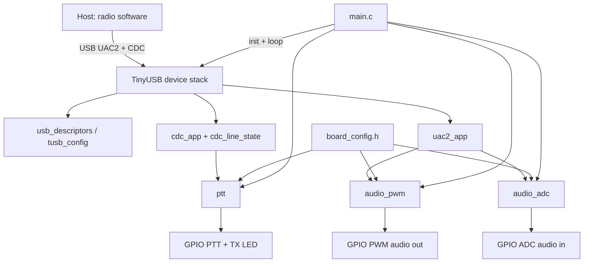

# Firmware Architecture (As-Built)

This document is the **normative architecture** for `rignexo/firmware`. It
started as an as-built capture (`RGNX_FW_ASBUILT_V1`), was updated by
`RGNX_FW_PINMAP_V1` for the shared pin map, and by `RGNX_FW_DEVICE_MODES_V1`
for boot-time persistent device modes.

All agentic development methodology documentation in this firmware tree is
maintained in English.

Related:

- Product vocabulary and pin table:
  [`TECHNICAL_DEFINITIONS.md`](../TECHNICAL_DEFINITIONS.md)
- Device modes (COMPOSITE vs AUDIO_VOX):
  [`device_modes_architecture.md`](device_modes_architecture.md)
- Build / flash / host checks: [`BUILD.md`](../BUILD.md)
- Agentic roles: [`AGENTS.md`](../AGENTS.md),
  [`docs/methodology.md`](methodology.md)

Source handoffs: `RGNX_FW_ASBUILT_V1`, `RGNX_FW_PINMAP_V1`,
`RGNX_FW_DEVICE_MODES_V1`.

## Normative Language

- `MUST` means required by the as-built design.
- `MUST NOT` means prohibited by the as-built design.
- `SHOULD` means expected unless a later handoff overrides it.
- `MAY` means optional.

## Purpose

Provide a USB-connected interface between a host computer and an HF radio for
narrow-band digital modes (especially FT8):

- Host ↔ MCU: USB Audio (UAC2), and optionally USB CDC serial/control depending
  on **device mode** (see [`device_modes_architecture.md`](device_modes_architecture.md)).
- MCU ↔ radio: ADC receive audio, PWM transmit audio, GPIO PTT (+ TX indicator).

The first prototype prefers MCU peripherals and **passive** external analog
networks. High-fidelity audio, stereo, enclosure, and production PCB are out of
scope for this as-built stage.

## Device Modes (Summary)

Four persistent modes, selected only at power-up if `MODE_SWITCH` is held
(operator must disconnect to change mode; no runtime USB re-enumeration):

| Mode | Host sees | PTT | Mode LED (PIO, mostly ON) |
| --- | --- | --- | --- |
| `COMPOSITE` (1) | UAC2 + CDC | RTS/DTR line state | 1 short OFF pulse per cycle |
| `AUDIO_VOX` (2) | UAC2 only | VOX on speaker (TX) audio | 2 short OFF pulses per cycle |
| `COMPOSITE_CAT` (3) | UAC2 + CDC | Kenwood CAT `TX;`/`RX;` | 3 short OFF pulses per cycle |
| `APRS_TNC` (4) | CDC only (KISS); no UAC2 | Modem TXDELAY/TXTAIL | 4 short OFF pulses per cycle |

CAT: [`cat_ptt_mode_architecture.md`](cat_ptt_mode_architecture.md).  
APRS TNC: [`aprs_tnc_mode_architecture.md`](aprs_tnc_mode_architecture.md).

Unknown/corrupt flash → effective `COMPOSITE` + heal rules; button path is
anti-glitch with **at most one flash write per boot**. Mode LED MUST use PIO
(no CPU blink loop).

**GPIO 0:** exclusive MODE_LED (PIO). Waveshare default UART0 TX on pin 0 is
**forbidden** for this project after LED start — do **not** call
`stdio_init_all()` / UART stdio on 0/1 (tester FAIL root cause). See
[`device_modes_architecture.md`](device_modes_architecture.md) § Mode LED.

Full contract: [`device_modes_architecture.md`](device_modes_architecture.md).

## System Boundary

**In scope (firmware tree):**

- Application sources under `src/`.
- CMake project using TinyUSB `family_support.cmake` + Pico SDK.
- Helper scripts under `scripts/` for build, flash, and host checks.
- Cloned TinyUSB under `external/tinyusb` (build-managed).

**Out of scope:**

- Sibling `../hardware/` PCB work (separate ownership).
- Active analog isolation / amplification unless a later handoff requires it.
- Custom USB VID/PID branding (as-built keeps TinyUSB example IDs).

## Stack

| Layer | Choice |
| --- | --- |
| MCU family | **Primary:** Raspberry Pi **RP2350**. **Also:** RP2040 via `CHIP=rp2040` |
| Board (default) | `waveshare_rp2350_zero` (**RP2350-Zero**) |
| Board (compat) | `waveshare_rp2040_zero` (**RP2040-Zero**, same GPIO map) |
| SDK | Raspberry Pi Pico SDK (`PICO_SDK_DIR`, default `/home/libertad/pico/pico-sdk`) |
| USB stack | TinyUSB device stack, **no RTOS** (`CFG_TUSB_OS = OPT_OS_NONE`) |
| USB example base | Official TinyUSB **`cdc_uac2`** composite headset + CDC |
| TinyUSB integration | `family_support.cmake` (`FAMILY=rp2040`, `BOARD=pico_sdk`) |
| TinyUSB git ref | Pinned `375e20090a0a60fd2d47ba6553d189e05482dfea` (not floating `master`) |
| Build generator | CMake + Ninja via `./scripts/build.sh` |
| Artefacts | `build/<chip>/rpi_pico_composite_sound_serial.{uf2,elf,…}` |
| Linked SDK libs | `hardware_pwm`, `hardware_adc` (plus TinyUSB/family defaults) |

CMake entry ([`CMakeLists.txt`](../CMakeLists.txt)):

- Requires `TINYUSB_ROOT` with `hw/bsp/family_support.cmake`.
- Project name: `rpi_pico_composite_sound_serial`.
- Sources: all application `.c` files under `src/` listed explicitly.
- `family_configure_device_example(... noos)`.

Build script defaults ([`scripts/build.sh`](../scripts/build.sh)):

- `CHIP=rp2350` → `build/rp2350`, board `waveshare_rp2350_zero`.
- `CHIP=rp2040` → `build/rp2040`, board `waveshare_rp2040_zero`.
- Passes `-DFAMILY=rp2040 -DBOARD=pico_sdk -DPICO_BOARD=…`.

## Layers

## Module Boundaries

| Module | Responsibility | MUST NOT |
| --- | --- | --- |
| `main.c` | `board_init`, peripheral init, `tusb_init`, main loop (`tud_task`, blink, `audio_task`); mount/umount failsafe | Own pin numbers; implement CDC echo or UAC2 streaming logic |
| `board_config.h` | Sole home for GPIO numbers, ADC index, sample rate/bits, PTT polarity/line, PWM wrap/clkdiv | Contain USB descriptor logic |
| `tusb_config.h` | TinyUSB class enables and AUDIO/CDC buffer/format macros | Drive GPIO |
| `usb_descriptors.c/.h` | Device/config/string descriptors; interface enum; UAC2 entity IDs | Sample ADC/PWM |
| `cdc_app.c` | CDC RX callback: echo bytes to host; brief on-board LED blink | Drive PTT |
| `cdc_line_state.c` | Strong `tud_cdc_line_state_cb`: map RTS or DTR → `ptt_set_active` | Touch audio rings |
| `ptt.c/.h` | Init PTT + TX indicator GPIOs; assert/deassert both together; `ptt_force_inactive` | Parse USB |
| `uac2_app.c` | UAC2 control callbacks; `audio_task` bridging USB ↔ PWM/ADC rings; blink task | Hard-code board pins (use `board_config.h`) |
| `audio_pwm.c/.h` | PWM output + ring + 48 kHz repeating timer | Own USB descriptors |
| `audio_adc.c/.h` | ADC input + ring + 48 kHz repeating timer | Own PTT |
| `common.h` | Shared blink interval enums, volume control constants, task prototypes | Pin defines |

### Initialization order (as-built)

1. `board_init()`
2. `ptt_init()`
3. `audio_pwm_init()`
4. `audio_adc_init()`
5. `tusb_init(...)`
6. Loop: `tud_task()` → `led_blinking_task()` → `audio_task()`

On USB unmount: `ptt_force_inactive()`, `audio_pwm_stop()`, `audio_adc_stop()`.

## USB Composite Contract

Interfaces ([`usb_descriptors.h`](../src/usb_descriptors.h)):

| Index | Role |
| --- | --- |
| 0 | Audio control |
| 1 | Audio streaming speaker |
| 2 | Audio streaming microphone |
| 3 | CDC communication |
| 4 | CDC data |

Host CDC port: **`…-if03`** under `/dev/serial/by-id/`.

Device identity (as-built example IDs):

- VID: `0xCafe`
- Product string lineage: **TinyUSB headset** (example descriptors)
- Device class: Misc / IAD

TinyUSB classes enabled ([`tusb_config.h`](../src/tusb_config.h)):

- `CFG_TUD_CDC = 1`, `CFG_TUD_AUDIO = 1`
- Audio: mono TX and mono RX channels; format 1 = 16-bit; format 2 = 24-bit in
  32-bit slots (non-RX platforms); max sample rate macro allows up to 96 kHz
  for descriptor sizing — application audio path targets **48 kHz** via
  `BOARD_AUDIO_SAMPLE_RATE_HZ`.

### CDC behavior

- RX callback echoes received data (`cdc_app.c`).
- Echo MUST NOT gate on `tud_cdc_connected()`.
- Line-state callback maps host control line to PTT:
  - If `BOARD_PTT_USE_RTS_LINE == 1` (as-built): **RTS** drives transmit.
  - Else: **DTR** drives transmit.

### UAC2 / audio path behavior

- Speaker (host → device): USB samples converted toward int16 and pushed into
  `audio_pwm` ring; PWM timer drains at `BOARD_AUDIO_SAMPLE_RATE_HZ`.
- Microphone (device → host): ADC timer fills ring; `audio_task` feeds USB IN
  when mic streaming is active.
- Start/stop of PWM/ADC paths is tied to UAC2 interface alt-setting open/close
  callbacks in `uac2_app.c`.
- Ring capacity (each path): 4096 int16 samples.
- PWM mapping: PCM16 centered → duty using `BOARD_PWM_WRAP` / `BOARD_PWM_CLKDIV`.
- ADC mapping: raw 12-bit centered at 2048, shifted to PCM16
  (`(raw - 2048) << 4`).

## Board Pin Contract

**Primary product board:** Waveshare **RP2350-Zero**.

**Backward compatibility:** Waveshare **RP2040-Zero** MUST use the **same**
GPIO assignments. One shared map in [`src/board_config.h`](../src/board_config.h)
serves both `CHIP=rp2350` and `CHIP=rp2040` builds. Do **not** introduce
per-chip `#ifdef` pin tables unless a later handoff explicitly requires it.

**Authoritative sources (must stay aligned):**

1. This section / [`TECHNICAL_DEFINITIONS.md`](../TECHNICAL_DEFINITIONS.md)
2. [`src/board_config.h`](../src/board_config.h) (runtime)

| Logical signal | Define | GPIO | Status |
| --- | --- | --- | --- |
| `RADIO_AUDIO_IN` | `BOARD_RADIO_AUDIO_IN_GPIO` | **28** (ADC2 / `BOARD_ADC_INPUT_INDEX` = 2) | Active |
| `RADIO_AUDIO_OUT` | `BOARD_RADIO_AUDIO_OUT_GPIO` | **2** (PWM) | Active |
| `RADIO_PTT_OUT` | `BOARD_RADIO_PTT_OUT_GPIO` | **14** (PTT relay) | Active |
| `TX_STATUS_INDICATOR` | `BOARD_TX_INDICATOR_GPIO` | **27** (PTT LED) | Active |
| `MODE_SWITCH` | `BOARD_MODE_SWITCH_GPIO` | **15** | Active (boot-time mode select; active high) |
| `MODE_LED` | `BOARD_MODE_LED_GPIO` | **0** | Active (PIO forever-pattern; active high) |

Other constants unchanged: 48 kHz / 16-bit audio; PTT and TX LED active-high;
PTT from RTS when `BOARD_PTT_USE_RTS_LINE = 1` in `COMPOSITE`; PWM wrap 255 /
clkdiv 4.0. Mode switch/LED levels:
`BOARD_MODE_SWITCH_ACTIVE_LEVEL = 1` (pressed = high; pull-down idle),
`BOARD_MODE_LED_ACTIVE_LEVEL = 1`.

### Active behavior rules

- PTT relay and PTT LED MUST always follow the same logical transmit state
  (`ptt_apply`).
- Mode selection and MODE_LED follow
  [`device_modes_architecture.md`](device_modes_architecture.md)
  (`RGNX_FW_DEVICE_MODES_V1`). Mode changes MUST NOT occur at runtime.

### Implementer note

- `RGNX_FW_PINMAP_V1`: shared pin defines in `board_config.h` (done).
- `RGNX_FW_DEVICE_MODES_V1`: boot store, dual USB, VOX — see
  `agent-workspaces/implementer/handoff.md` (**pending**).

## Validated Behavior Snapshot

- Composite enumeration: CDC + UAC2.
- CDC serial echo.
- Host RTS → PTT relay GPIO **14** + PTT LED GPIO **27**.
- USB speaker → PWM GPIO **2**; USB microphone ← ADC GPIO **28**.

Host validation entry points: `BUILD.md`, `docs/test_strategy.md`,
`agent-workspaces/tester/procedures.md`.

## Build and Flash Ownership

| Concern | Owner |
| --- | --- |
| Edit `scripts/*`, `CMakeLists.txt`, `src/*` | Implementer (with handoff) |
| Run build/flash/host checks | Tester |
| Specify chip/board/contracts | Architect |

Default artefact path: `build/rp2350/rpi_pico_composite_sound_serial.uf2`.

## Non-Goals (As-Built Stage)

- Stereo audio requirement.
- Active analog front-end as part of firmware scope.
- Finished enclosure / production PCB inside this tree.
- Relying on globally exported `PICO_SDK_PATH` (scripts use explicit paths).
- Custom commercial USB IDs.

## Open Questions

1. Passive input/output network values remain hardware decisions
   (`TODO(rgnx-fw):` in product docs).
2. Whether PTT needs isolation/level shifting for a specific HF radio remains
   outside firmware architecture until hardware defines it.
3. Final VOX threshold / hang-time bench tuning after `AUDIO_VOX` lands
   (initial ranges are in `device_modes_architecture.md`).
