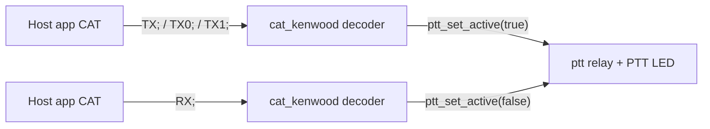

# CAT PTT Mode Architecture (`COMPOSITE_CAT`)

Normative architecture for **mode 3**: USB Audio + CDC serial with PTT driven by
**CAT commands** (not RTS/DTR, not VOX).

Source handoff: `agent-workspaces/architect/handoff.md`, `RGNX_FW_CAT_PTT_V1`.

Related: [`device_modes_architecture.md`](device_modes_architecture.md),
[`architecture.md`](architecture.md).

All agentic development methodology documentation in this firmware tree is
maintained in English.

## Normative Language

- `MUST` / `MUST NOT` / `SHOULD` / `MAY` as in other architecture docs.

## Purpose

Some HF digital apps key transmit with **CAT** rather than RTS/DTR on the serial
port. Mode 3 presents the same USB composite surface as mode 1 (UAC2 + CDC) but
interprets a small Kenwood-compatible CAT dialect so those apps can assert and
release the PTT relay without using line-state PTT.

## CAT ecosystem options (survey)

| Family | Shape | PTT / TX keying | Host software prevalence | Fit for this MCU stub |
| --- | --- | --- | --- | --- |
| **Kenwood** (TS-480 / TS-2000 style) | ASCII, commands end with `;` | `TX;` / `TX0;` / `TX1;` on air; `RX;` receive | Very high; WSJT-X / flrig / many apps offer “Kenwood TS-2000” or similar | **Best** — easy to parse; one stream of bytes |
| **Icom CI-V** | Binary frames, fixed address byte | TX via CI-V “transceiver” / PTT opcodes | Very high (IC-7300 class) | Harder — framing, address, checksums |
| **Yaesu** (FT-817 / FT-991 / newer) | Multiple dialects (binary and ASCII variants) | Often CAT **plus** second COM RTS; dialects differ by model | High, but fragmented | Poor as single fake profile |
| **Elecraft** | Kenwood-like ASCII subset | Similar TX/RX style | Moderate | Possible later alias of Kenwood subset |
| **Hamlib / flrig** | Abstraction over the above | Depends on selected rig backend | High as middleware | Device still needs a concrete wire protocol |

**Architect choice for v1:** emulate a **Kenwood TS-2000–class ASCII CAT**
profile (semicolon-terminated). Rationale: widest “pick this rig in the app”
habit for generic interfaces, simplest decoder on RP2350/RP2040, and clear PTT
verbs.

Non-goals for v1: real CI-V, Yaesu binary, Elecraft-only extensions, or full
radio simulation.

## Mode summary

| Mode ID | Index | USB | PTT source | MODE_LED |
| --- | --- | --- | --- | --- |
| `COMPOSITE` | 1 | UAC2 + CDC | RTS/DTR line state | 1 OFF pulse |
| `AUDIO_VOX` | 2 | UAC2 only | Speaker VOX | 2 OFF pulses |
| `COMPOSITE_CAT` | 3 | UAC2 + CDC | Kenwood-style CAT TX/RX | **3** OFF pulses |

Boot cyclic order:

`COMPOSITE` → `AUDIO_VOX` → `COMPOSITE_CAT` → `COMPOSITE` → …

Persistence, anti-glitch button, invalid-mode heal, and dual-PID USB rules from
`device_modes_architecture.md` still apply. Extend the mode enum and LED PIO
with a **3-pulse** program (same OFF/GAP/quiet timings).

USB surface for `COMPOSITE_CAT` MUST match `COMPOSITE` (CDC present, including
`…-if03`). Distinct USB PID bit for mode 3 SHOULD be used (same policy as mode 2).

## PTT rules in `COMPOSITE_CAT`



- PTT MUST be driven **only** by CAT TX/RX handling in this mode.
- CDC **RTS/DTR MUST NOT** call `ptt_set_active` in `COMPOSITE_CAT` (ignore
  line-state for PTT). Echo of serial data MAY continue or be replaced by CAT
  framing — see serial behavior below.
- VOX MUST NOT drive PTT in this mode.
- USB unmount / failsafe MUST `ptt_force_inactive` as in other modes.

### TX / RX verbs (normative)

Treat as **PTT assert** (any of):

- `TX;`
- `TX0;`
- `TX1;`

Treat as **PTT release**:

- `RX;`

Matching MUST be case-sensitive ASCII as Kenwood documents (`T`,`X`, digits,
`;`). Implementer MAY accept optional leading whitespace; MUST NOT require it.

After a successful TX* command, firmware SHOULD reply in a Kenwood-like way
(empty ack or echo of command — pick one and keep it stable; default: **no
payload required beyond normal AI/IF stubs** if the host does not require an
echo). Prefer answering queries; for TX/RX, answering with nothing or with the
same command terminated by `;` is acceptable if documented in implementer notes.

## Soft radio state in RAM (dynamic stubs)

Tester feedback (`RGNX_FW_CAT_PTT_V1`): PTT CAT works, but apps **set**
frequency/mode and then **read back** fixed constants → host UI / CAT test
looks wrong or incomplete.

**Normative change (`RGNX_FW_CAT_STATE_RAM_V1`):** the Kenwood facade MUST keep
a small **RAM soft-radio state**. What the host **sets**, later **queries**
MUST return (same session). There is still **no** real RF synthesizer; audio
and PTT paths are unchanged except PTT from TX/RX as already specified.

### Soft state (minimum + common app knobs)

Apps do **not** only set frequency. They also set filter **width**, mode, and
often other “radio knobs”. All of the following MUST live in RAM with the same
**set → store → get returns stored** rule.

| Field | Kenwood cmd | Meaning | Cold-start default (locked) |
| --- | --- | --- | --- |
| `vfo_a_hz` | `FA` | VFO-A Hz | `14074000` (14.074 MHz FT8 20 m) |
| `vfo_b_hz` | `FB` | VFO-B Hz | `14074000` (same — no split) |
| `md_code` | `MD` | Mode | `2` (USB) |
| `fw_hz` | `FW` | Filter width Hz | `2700` |
| `sl_val` | `SL` | SSB low cut | `00` |
| `sh_val` | `SH` | SSB high cut | `08` (pair with SL for ~wide SSB/digi) |
| `pc_pct` | `PC` | Power | `100` (100%) |
| `fr_vfo` | `FR` | RX VFO | `0` (A) |
| `ft_vfo` | `FT` | TX VFO | `0` (A) |
| `ai_mode` | `AI` | Auto-info | `0` |
| `rg_val` | `RG` | RF gain | `100` (or Kenwood max digit style — encode consistently) |
| `ag_val` | `AG` / `AG0` | AF gain | `100` |
| `sq_val` | `SQ` | Squelch | `000` (open) |

### Cold-start profile (before the app sets anything)

On `cat_kenwood_init` / enter `COMPOSITE_CAT`, firmware MUST load the table
defaults above so the **first** host polls look like a quiet USB digi radio on
20 m FT8 — coherent together, not random zeros/`?;`.

**Story for the host:** “TS-2000-class, VFO A/B on 14.074 MHz, USB, ~2.7 kHz
width, full power available, VFO A for RX/TX, not transmitting, squelch open.”

Example **first get** replies (normative encodings):

| Get | Reply |
| --- | --- |
| `ID;` | `ID019;` (constant) |
| `FA;` | `FA00014074000;` |
| `FB;` | `FB00014074000;` |
| `MD;` | `MD2;` |
| `FW;` | `FW0002700;` |
| `SL;` | `SL00;` |
| `SH;` | `SH08;` |
| `PC;` | `PC100;` |
| `FR;` | `FR0;` |
| `FT;` | `FT0;` |
| `AI;` | `AI0;` |
| `RG;` | `RG100;` (match encode used on set) |
| `AG;` / `AG0;` | `AG0xxx;` / documented form with stored gain |
| `SQ;` | `SQ000;` |
| `IF;` | **Exact** Hamlib TS-2000 `IF` frame (see § IF frame) — cold-start example below |
| `SM;` | `SM00000;` (harmless S-meter zero — optional but SHOULD so meter polls do not get `?;`) |

Cold-start `IF;` (normative wire string, **38** characters including `;`):

```text
IF00014074000      000000000020000000;
```

That encodes FA=`14074000`, MD=`2` (USB), VFO=`0` (A), TX=`0`, split=`0`.

If the app queries another simple meter/status get not listed, prefer a
harmless numeric zero reply over `?;` when it is a well-known Kenwood get with
no side effects; still use `?;` for truly unknown opcodes.

Notes:

- **`FW` is the usual “width”** command; SSB apps may use `SL`/`SH` instead —
  both MUST be in soft state with the cold-start pair above.
- State is **RAM only** (reset to this profile on power cycle / re-init).
- MUST NOT persist soft state in the mode flash slot.
- PTT remains GPIO via `TX*`/`RX*` only; `IF;` TX bit MUST follow real PTT.

### Set vs get (general rule)

For every parameter in the table above:

1. **Set** form (command + payload + `;`) → parse → update RAM → ack (no body
   or echo; one stable policy).
2. **Get** form (command + `;` only) → reply with **current RAM** value in the
   normal Kenwood encoding.
3. Malformed payload → `?;`, **no** state change.
4. Unknown command → `?;`.

| Host examples | Behavior |
| --- | --- |
| `FA00007074000;` then `FA;` | Second reply contains `00007074000` |
| `FW0002700;` then `FW;` | Reply `FW0002700;` (or same width encoding used on set) |
| `SL00;` / `SH07;` then get | Return stored SL/SH |
| `PC050;` then `PC;` | Return stored power |
| `MD1;` then `MD;` | Return `MD1;` |
| `IF;` | Built from **current** soft state per § IF frame (freq + MD + VFO + PTT + split) |
| `ID;` | Constant identity only (not app-settable) |

Digit widths (normative for parse/reject):

- `FA`/`FB`: **11** digits  
- `FW`: **4** digits (0000–9999 Hz style)  
- `PC`: **3** digits (Kenwood style)  
- `SL`/`SH`: as currently accepted by the existing parser length; keep
  consistent encode/decode  

### IF frame (Hamlib / WSJT-X — `RGNX_FW_CAT_IF_HAMLIB_V1`)

Tester return (2026-11-20): Linux scripted CAT PASS, but **WSJT-X Test CAT**
FAIL with Hamlib 4.7.1:

```text
rig_get_freq OK (14074000 USB)
cache: vfo=VFOA, current_vfo=None
kenwood_set_freq: unsupported VFO None
```

**Root cause (normative diagnosis):** Hamlib TS-2000 uses
`get_vfo = kenwood_get_vfo_if`, which reads `IF;` and maps
`priv->info[30]` → VFO A/B/MEM. Hamlib **strips** the trailing `;` then
requires `strlen(info) == if_len` (default **37**). So the wire reply MUST be
**exactly 38 bytes** including `;`. The prior soft-state `IF` was **37**
including `;` (36 after strip) → `kenwood_get_if` length fail →
`current_vfo` stays `None` → WSJT-X `set_freq(VFO None)` dies before `FA…;`.

#### Wire length (hard requirement)

| Item | Value |
| --- | --- |
| Characters on CDC including `;` | **38** |
| Characters after Hamlib strips `;` | **37** |
| Shorter or longer | **Forbidden** for `IF;` replies |

#### Field map (0-based indices into the **37-char** payload Hamlib keeps
after stripping `;` — same as wire without the final `;`)

Match Hamlib `kenwood.c` (`kenwood_get_vfo_if`, PTT/mode/split helpers):

| Index | Field | Allowed | Soft-state source |
| --- | --- | --- | --- |
| 0–1 | Opcode | `IF` | fixed |
| 2–12 | Frequency Hz, 11 digits | `0`–`9` | Active RX VFO: `vfo_a_hz` if `fr_vfo==0`, else `vfo_b_hz` if `fr_vfo==1` (MEM → use A) |
| 13–18 | Spacer | **six** ASCII spaces | fixed (`"      "`) — matches TS-2000 captures Hamlib accepts |
| 19–24 | RIT value | six digits | fixed `000000` (no `+`/`-` sign char) |
| 25 | RIT on/off | `0`/`1` | fixed `0` |
| 26 | XIT on/off | `0`/`1` | fixed `0` |
| 27 | Memory / padding | digit | fixed `0` |
| **28** | **TX / PTT** | `0`/`1` | live `ptt_is_active()` → `1` else `0` |
| **29** | **Mode (MD)** | Kenwood MD digit | `md_code` |
| **30** | **VFO select** | `0`=A, `1`=B, `2`=MEM | `fr_vfo` (`0`/`1`/`2`) — **this byte is why WSJT-X failed** |
| 31 | (padding) | `0` | fixed `0` |
| **32** | **Split** | `0`/`1` | `1` iff `fr_vfo != ft_vfo`, else `0` |
| 33–36 | Tone / padding | digits | fixed `0000` |

Indices **28 / 29 / 30 / 32** are exactly Hamlib `priv->info[28]` (TX),
`info[29]` (MD), `info[30]` (VFO), `info[32]` (split). Implementers MUST
`strlen` the reply without `;` and confirm it is **37**, then spot-check
those four bytes.

Quick check (cold-start, PTT idle):

```text
Wire (38):        IF00014074000      000000000020000000;
After strip (37): IF00014074000      000000000020000000
info[28]=TX='0', info[29]=MD='2', info[30]=VFO='0', info[32]=split='0'
```

> Layout note: with six spaces, index 28 is the 10th character of the
> 18-char trailer (`…000020000000` → TX=`0`, MD=`2`, VFO=`0`). Do not shift
> fields with a RIT sign character.

#### Behavioral rules

1. Every `IF;` get MUST use the frame above (no ad-hoc shorter stubs).
2. `FR;` / `FT;` set/get already in soft state; **`IF` VFO byte MUST follow
   `fr_vfo`**; split bit MUST follow `fr_vfo` vs `ft_vfo`.
3. Frequency digits MUST follow the RX VFO selected by `fr_vfo` (usually A).
4. Do **not** insert a `+`/`-` RIT sign that shortens later fields — that was
   the soft-state bug pattern (`…+000000000…` → wrong total length).
5. `FA`/`FB`/`MD` set-then-get remain required; they are not enough alone for
   WSJT-X — **`IF` length + VFO byte** are mandatory for Hamlib.

#### Non-goals (unchanged)

- Real RIT/XIT/tone/memory semantics beyond fixed zeros.
- CI-V / Yaesu.
- Persisting soft state across reboot.

### Extensibility (when tester sees more set-then-get)

If a host app sets another Kenwood read/write command (e.g. `RG`, `AG`, `SQ`,
`IS`, split-related) and then reads it back:

- Architect SHOULD add it to this table in a follow-up handoff, **or**
- Implementer MAY add a RAM field for that opcode under this handoff if the
  command is a simple get/set numeric/string stub and notes it in
  `implementer/handoff.md` (still no real RF).

Do **not** leave set commands as no-ops that keep returning the boot default.

### Explicitly still out of scope

- Real RF / hardware filters / PA / SWR meters.
- Persisting soft state across reboots.
- CI-V / Yaesu.
- Real RIT/XIT/tone/memory behavior (those IF columns stay fixed zeros as
  specified). **IF length, TX, MD, VFO, and split bits are in scope** (see
  § IF frame) — they are not optional dummies.

## Serial / CDC behavior

- Baud: host-selected; firmware CDC is USB and ignores UART baud. Document
  suggested host settings for apps: **9600 8N1** or **115200 8N1** (either is
  fine over USB CDC; recommend **9600 8N1** in user docs for Kenwood habits).
- Framing: accumulate bytes until `;` (max command length e.g. 64–128); overflow
  MUST reset buffer and MAY send `?;`.
- Do **not** use the old “echo every RX byte” CDC behavior for CAT payload in
  this mode if it confuses hosts; CAT request/response replaces echo.
  (COMPOSITE mode 1 may keep echo.)
- Line ending: commands end with `;`. CR/LF MAY be ignored if present.

## Module boundaries

| Module | Responsibility |
| --- | --- |
| `cat_kenwood` | Parse `;`-terminated commands; TX/RX → `ptt_*`; RAM soft state for FA/FB/MD; IF from state |
| `cdc_app` | In `COMPOSITE_CAT`, feed RX bytes to `cat_kenwood`; TX replies via CDC |
| `cdc_line_state` | Active for PTT **only** in `COMPOSITE`; ignored for PTT in `COMPOSITE_CAT` |
| `mode_store` / LED PIO | Enum value 3; 3-pulse LED pattern |
| `ptt` | Unchanged contract |

`main.c` stays thin; no CAT logic in `main`.

## Host operator guidance (for README / BUILD later)

In WSJT-X / similar:

- Rig: **Kenwood TS-2000** (or closest Kenwood CAT entry)
- PTT method: **CAT**
- Serial: the device CDC port (`…-if03`)
- Mode: USB; split as app requires (stubs may no-op split)

## Acceptance criteria (tester)

1. Mode 3 selected (3 LED off-pulses); USB shows audio + CDC.
2. Without CAT TX, PTT idle; RTS toggling MUST NOT key PTT.
3. Sending `TX;` or `TX1;` on CDC keys relay + PTT LED; `RX;` releases.
4. `FA…;` / `MD…;` / `FW…;` (and SL/SH/PC if sent) then matching get → same
   values; `IF;` tracks current FA/MD/VFO/PTT/split per § IF frame.
5. `ID;` constant; unknown → `?;`; power cycle resets **all** soft fields.
6. Mode cycle / device-mode flash persistence unchanged; builds rp2350 + rp2040.
7. **`RGNX_FW_CAT_IF_HAMLIB_V1`:** `IF;` wire length **38** (37 after stripping
   `;`); cold-start dump matches
   `IF00014074000      000000000020000000;` (PTT idle). Host check: after
   `IF;`, Hamlib-style parse must see VFO digit `0`. WSJT-X (or equivalent)
   **Test CAT** with Rig=TS-2000 MUST NOT fail with
   `kenwood_set_freq: unsupported VFO None`. Scripted Linux suite alone is
   **not** sufficient to close this handoff.

## Suggested implementer phases

1. (Done in `RGNX_FW_CAT_PTT_V1`) enum, LED 3-pulse, parser, TX/RX PTT, fixed stubs.
2. (Done in `RGNX_FW_CAT_STATE_RAM_V1`) RAM soft state for FA/FB/MD/**FW**/SL/SH/PC/FR/FT;
   IF from state; defaults on init; malformed → `?;`.
3. **`RGNX_FW_CAT_IF_HAMLIB_V1`:** rewrite `IF;` to Hamlib 38-byte frame; VFO
   byte from `fr_vfo`; split from FR/FT; no RIT sign shift; keep set-then-get.
4. Tester: length + VFO byte checks; WSJT-X Test CAT on Mac/Linux Hamlib.
