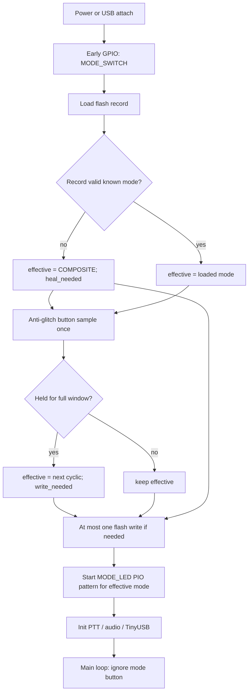
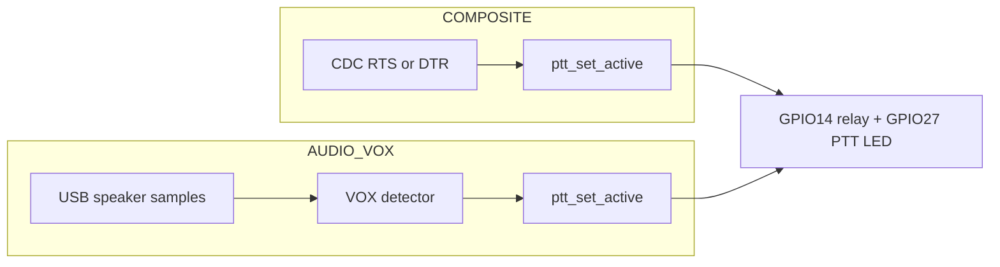

# Device Modes Architecture (Boot-Time, Persistent)

Normative architecture for dual device modes in `rignexo/firmware`.

Source handoff: `agent-workspaces/architect/handoff.md`,
`RGNX_FW_DEVICE_MODES_V1` (amended UX / anti-glitch / PIO / invalid mode).

Related:

- [`architecture.md`](architecture.md) — overall firmware architecture
- [`TECHNICAL_DEFINITIONS.md`](../TECHNICAL_DEFINITIONS.md) — pins and vocabulary
- [`test_strategy.md`](test_strategy.md) — validation expectations

All agentic development methodology documentation in this firmware tree is
maintained in English.

## Normative Language

- `MUST` means required.
- `MUST NOT` means prohibited.
- `SHOULD` means expected unless there is a strong platform reason not to.
- `MAY` means optional.

## Purpose

Support two host-visible personalities without runtime USB re-enumeration:

1. **COMPOSITE** (mode 1) — USB Audio (UAC2) + USB CDC serial (current product
   behavior). PTT from host RTS (or DTR per `BOARD_PTT_USE_RTS_LINE`).
2. **AUDIO_VOX** (mode 2) — USB Audio only (no CDC interface). PTT from VOX
   detection on host→radio (speaker) audio. Improves compatibility with
   hosts/OSes that mishandle or reject composite serial ports.

Mode changes are **permanent** until changed again, and are performed only at
**power-up / USB attach** while the mode pushbutton is held. The operator
**MUST** disconnect (unplug USB or full power cycle) to change mode. The
pushbutton **MUST NOT** change mode while the device is already running.

## Modes (v1)

| Mode ID | Index | Host USB surface | PTT source |
| --- | --- | --- | --- |
| `COMPOSITE` | 1 | UAC2 + CDC | CDC line state (RTS default) |
| `AUDIO_VOX` | 2 | UAC2 only (no CDC) | Speaker-path VOX |

Cyclic order: `COMPOSITE` → `AUDIO_VOX` → `COMPOSITE` → …

Mode LED indication is **not** a static on/off level; see **Mode LED (PIO)**.

## Invalid or Unknown Stored Mode

If the persisted record is missing, has bad magic/checksum, or the mode field
is **any value other than** the defined enum members (`COMPOSITE`,
`AUDIO_VOX`):

1. Firmware MUST treat the effective mode for **this boot** as **`COMPOSITE`**.
2. Firmware MUST NOT crash, assert-loop, or leave USB uninitialized.
3. Firmware MUST **heal** storage with a single write of a valid `COMPOSITE`
   record **unless** the boot path will already perform one legitimate mode
   advance write (button held): in that case the single allowed write MUST
   store the **advanced** valid mode (heal + advance collapsed into one write).
4. Firmware MUST NOT repeatedly rewrite flash on every boot for the same
   valid content (compare-before-write).

Summary: unknown → safe default `COMPOSITE` in RAM; at most one flash write
this boot to restore a valid image (and/or apply button advance).

## Boot Sequence



### Normative boot rules

1. Before `tusb_init`, resolve mode completely (load, validate, optional
   advance, optional single flash write, start mode LED PIO).
2. Debounce / anti-glitch for the switch: see **Button anti-glitch**.
3. Runtime presses of `MODE_SWITCH` MUST be ignored for mode changes.

Operator procedure: hold mode button → plug USB (or power) → release after
LED pattern shows the new mode → unplug and replug without button to confirm
persistence.

## Button Anti-Glitch and Flash Write Limiting

Goal: one human “hold on connect” → **at most one** mode advance and **at most
one** flash program cycle per boot, despite bounce, EMI, or long holds.

Firmware MUST:

1. **Sample once per boot** — a single decision path; no polling loop that can
   re-trigger advance while USB is already up.
2. **Settle then confirm** — after GPIO + pull-down ready, wait a short settle
   (e.g. 10–20 ms), then require the switch to remain in the active state
   continuously for **50–100 ms**. Any release during that window → treat as
   **not held**. Active = **high** (see Hardware UI Pins).
3. **At most one advance** — if held, advance exactly one step in the cycle;
   do not auto-repeat while the button stays down.
4. **At most one flash write per boot** — combine heal + advance into a single
   write when both apply; if the would-be stored value equals what is already
   validly stored, MUST NOT erase/program.
5. **No write on clean boot** — button not held and stored mode already valid →
   zero flash writes.
6. **Ignore after decision** — after the boot decision completes, mode-switch
   edges MUST NOT call `mode_store` save.

Long press across the entire boot is still **one** advance only.

## Mode LED (PIO) — Clear Rules for Implementer and Tester

### What the human MUST see (not a classic 50% blink)

The external green MODE_LED is **almost always lit**. The mode is encoded only
as brief **dips to OFF**, then back to ON. It is easy to misread if looking for
a continuous blink; look for **short dark flashes on a steady green**.

Timeline (active-high LED; `█` = ON, `_` = OFF):

**Mode 1 — `COMPOSITE` (sound + serial)** — one dark flash per cycle:

```text
███████████████████████████████_███████████████████████████████_███ …
|← —— quiet ON ~800 ms —— →|↑|← —— quiet ON again —— →|
                              ~150 ms OFF
```

**Mode 2 — `AUDIO_VOX` (sound + autovox)** — two dark flashes per cycle:

```text
████████████████████_███_████████████████████_███_███ …
|← quiet ON ~800 ms →|↑|↑|← —— quiet ON —— →|
                      OFF GAP OFF
                     ~150 ~150 ~150 ms
```

| Mode | What to count | Cycle (approx.) |
| --- | --- | --- |
| `COMPOSITE` (1) | **1** short OFF per ~1 s | quiet ON 700–1000 ms; OFF 120–180 ms |
| `AUDIO_VOX` (2) | **2** short OFFs, then a long ON | same OFF/gap widths; quiet ON 700–1000 ms |

Constants live in `board_config.h` (`BOARD_MODE_LED_OFF_MS`,
`BOARD_MODE_LED_GAP_MS`, `BOARD_MODE_LED_QUIET_ON_MS`). Same values on RP2350
and RP2040.

Patterns MUST run **forever** until power loss / reset.

### What is NOT the mode LED

- The Waveshare module **WS2812 RGB** on GPIO **16** is **not** MODE_LED.
- PTT LED on GPIO **27** is **not** MODE_LED.
- Acceptance is only on the external LED wired to GPIO **0**.

### GPIO 0 exclusive ownership (architect decision: Option A)

Waveshare RP2350-Zero / RP2040-Zero board headers default
`PICO_DEFAULT_UART_TX_PIN` = **0** (UART0 TX). That **conflicts** with
`BOARD_MODE_LED_GPIO` = **0**.

**Normative decision:** keep MODE_LED on GPIO **0**. Product debug UART on
pins 0/1 is **not** part of this firmware.

| Rule | Requirement |
| --- | --- |
| Owner of GPIO 0 | **Only** MODE_LED PIO after `mode_led_pio_start()` |
| UART on 0/1 | **MUST NOT** be used for the life of the firmware after LED start |
| `stdio_init_all()` | **MUST NOT** be called (it re-inits UART TX on GPIO 0 and kills the pattern) |
| `stdio_uart_init` / `uart_init` on UART0 with TX=0 | **MUST NOT** run after LED start |
| `board_init()` | MAY briefly mux GPIO 0 as UART TX (TinyUSB BSP). That is tolerated **only before** LED start. |
| After LED start | **No** code path MAY remux GPIO 0 away from the MODE_LED PIO SM |

**Allowed debug console in v1:** none on UART0/0-1. USB CDC (in `COMPOSITE`)
or SWD are acceptable if needed later; do not reclaim GPIO 0.

### Required init order

```text
1. board_init()                         // BSP may touch GPIO0 as UART TX
2. mode_boot_resolve()                  // flash + button
3. mode_led_pio_start(effective_mode)   // MUST claim GPIO0 for PIO here
4. other peripheral inits, tusb_init()
5. main loop                            // MUST NEVER call stdio_init_all / UART0 on pin 0
```

If any step after (3) remuxes GPIO 0, the LED acceptance test **FAILS** even
if the PIO SM is still “enabled”.

### PIO requirement

- Waveform MUST come from a **PIO state machine** (`.pio` program), not a CPU
  busy-loop or main-loop toggle.
- After start, CPU MUST NOT need periodic work to keep the pattern alive.
- Document which PIO block/SM in implementer notes (current preference: PIO1
  SM0 is fine if free).
- Do **not** fall back to a USB-blocking blink loop without a new architect
  handoff.

Module: `mode_led_pio` — `mode_led_pio_start(mode)` loads the 1-pulse or
2-pulse program and enables the SM once.

## Persistence

- Firmware MUST store the mode enum in on-board flash (dedicated page/slot via
  Pico flash APIs; same policy on RP2350 and RP2040).
- Flash writes ONLY per **Button anti-glitch** rules above.
- See **Invalid or Unknown Stored Mode** for corrupt/unknown handling.

Suggested logical layout (implementer MAY refine):

```text
magic (u32) + mode (u8) + reserved + checksum
```

Valid `mode` values MUST be only the defined enum integers. Any other byte is
unknown.

## USB (No Runtime Re-enumeration)

- Descriptor / configuration set is chosen **before** `tusb_init` from the
  selected mode.
- `COMPOSITE`: same as current as-built — audio interfaces 0–2, CDC 3–4,
  host CDC `…-if03`.
- `AUDIO_VOX`: UAC2 only; CDC interfaces and CDC class MUST NOT appear to the
  host; CDC app / line-state callbacks MUST NOT run.
- Product ID SHOULD differ between modes (use the existing TinyUSB-style PID
  bitmap / a dedicated bit) so hosts do not reuse stale COM port bindings.
- Firmware MUST NOT disconnect/reconnect USB at runtime to switch modes in v1.

## PTT by Mode



### Shared PTT contract

- `ptt_set_active` / `ptt_force_inactive` remain the only drivers of
  `RADIO_PTT_OUT` (14) and `TX_STATUS_INDICATOR` (27); both MUST stay in sync.
- USB unmount / failsafe MUST force PTT inactive in every mode.

### COMPOSITE

- PTT MUST follow CDC line state as today (`cdc_line_state.c`).
- VOX MUST NOT assert or release PTT.

### AUDIO_VOX

- PTT MUST follow the VOX detector only.
- VOX input MUST be the **speaker** path (host → device → PWM toward the radio),
  evaluated when speaker samples are received / written (e.g. in `audio_task` or
  adjacent helper). VOX MUST NOT use the ADC RX path in v1.
- Suggested v1 parameters in `board_config.h` (tunable later):

| Parameter | Intent | Initial guidance |
| --- | --- | --- |
| Activity threshold | Peak or mean-abs level above silence | Start conservative; tune on bench |
| Hang time | Delay after activity drops before PTT off | 200–500 ms |
| Attack / min on | Ignore single-sample clicks | Short window or min samples |

- When speaker streaming stops / interface closes, PTT MUST go inactive after
  hang time or immediately on stream stop (implementer SHOULD release promptly
  on stream stop and still honor hang time for brief gaps while streaming).

## Hardware UI Pins

| Signal | GPIO | Define | Electrical (v1) |
| --- | --- | --- | --- |
| `MODE_SWITCH` | 15 | `BOARD_MODE_SWITCH_GPIO` | Input; **active high** (+3V3 via SW, external pull-down to GND) |
| `MODE_LED` | 0 | `BOARD_MODE_LED_GPIO` | Output via **PIO**; **active high** |

Also define:

- `BOARD_MODE_SWITCH_ACTIVE_LEVEL` = 1
- `BOARD_MODE_LED_ACTIVE_LEVEL` = 1
- Firmware MUST enable internal pull-down (or rely on external R to GND) and
  MUST NOT enable pull-up on MODE_SWITCH (would fight the mainboard).
- Timing constants for LED off-pulse / cycle (names up to implementer)

## Module Boundaries (Implementation)

| Module | Responsibility | MUST NOT |
| --- | --- | --- |
| `mode_store` (new) | Load/save/heal mode in flash; compare-before-write | Touch USB, PTT, or LED bit-bang |
| Boot path in `main` (or `mode_boot`) | Anti-glitch button sample once; orchestrate heal/advance/single write | Call `tusb_init` before mode decision; multi-write loops |
| `mode_led_pio` | PIO SM forever-pattern; exclusive GPIO0 owner after start | Call `stdio_init_all`; remux GPIO0 to UART; CPU blink loops |
| `usb_descriptors` / `tusb_config` | Expose descriptor set for current mode | Change mode at runtime |
| `vox` (new) | Detect activity; call `ptt_set_active` only in `AUDIO_VOX` | Drive GPIOs directly |
| `cdc_app` / `cdc_line_state` | Active only in `COMPOSITE` | Run in `AUDIO_VOX` |
| `ptt` | Relay + PTT LED | Know USB class details |
| `uac2_app` / `audio_pwm` | Feed VOX from speaker samples when in `AUDIO_VOX` | Own flash mode storage |

`main.c` MUST stay thin: resolve mode → start PIO LED → init peripherals →
`tusb_init` → loop.

## Non-Goals (v1)

- Changing mode without disconnect / power cycle.
- More than two modes.
- VOX on ADC receive audio.
- Host-configurable VOX threshold via CDC/USB.
- Runtime USB tear-down/re-init to switch descriptors.
- CPU-driven mode LED blinking in the main loop.

## Acceptance Criteria (Tester)

1. Cold boot without button → last saved mode (or `COMPOSITE` if virgin/invalid
   flash); at most one heal write when invalid; valid clean boot → no write.
2. Hold button on plug-in → **exactly one** mode advance despite bounce/long
   hold; pattern matches mode; survives unplug/replug without button.
3. LED on GPIO0: steady green with **1** short dark flash (`COMPOSITE`) or **2**
   (`AUDIO_VOX`) per ~1 s cycle, forever. Not a 50% blink. WS2812/PTT LED do
   not count. Pattern still visible after full boot (no UART reclaim of GPIO0).
4. Inject/simulate unknown mode byte (or document factory corrupt test) → boots
   `COMPOSITE`, heals or advances with a single write policy as specified.
5. `COMPOSITE`: host sees CDC (`…-if03`) + audio; RTS keys PTT; VOX does not.
6. `AUDIO_VOX`: audio without CDC/COM; TX audio keys PTT; hang releases PTT.
7. Builds for `CHIP=rp2350` and `CHIP=rp2040`.

## Suggested Implementer Phases

1. `mode_store` (validate/heal/compare-before-write) + anti-glitch boot button +
   `mode_led_pio` patterns (USB may still be composite-only).
2. Dual USB descriptor sets + mode-gated CDC; distinct PID.
3. VOX module wired to speaker path; gate PTT sources by mode.
4. Tester validation per acceptance criteria above.
